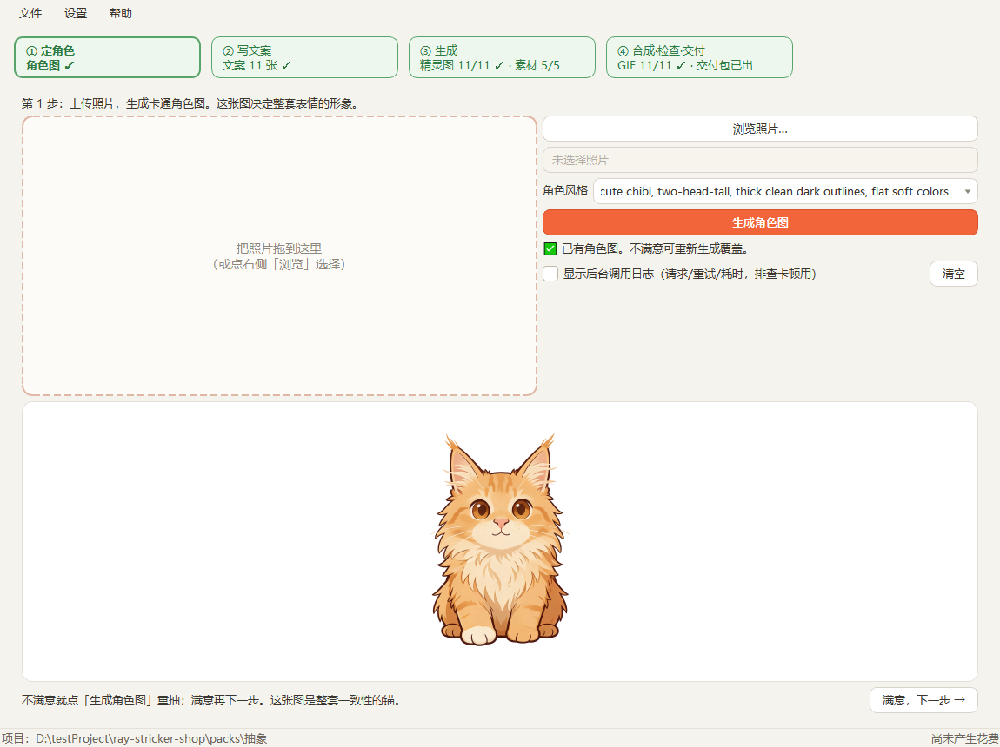
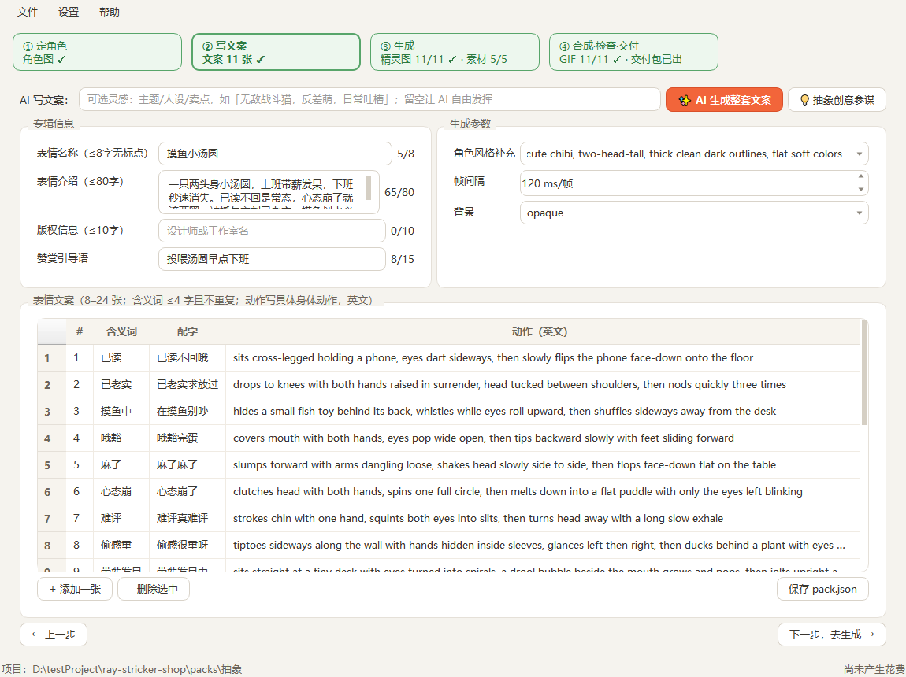
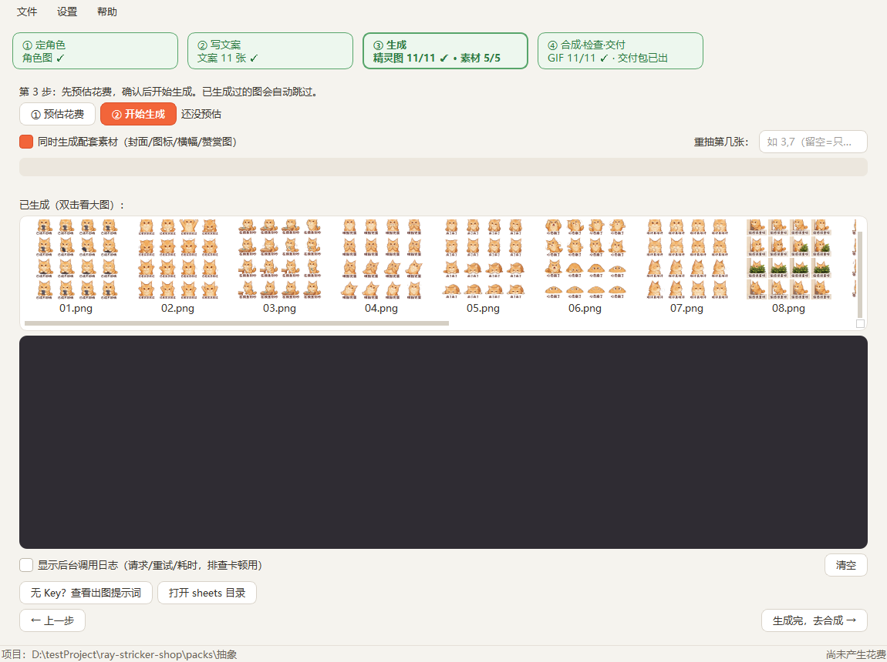
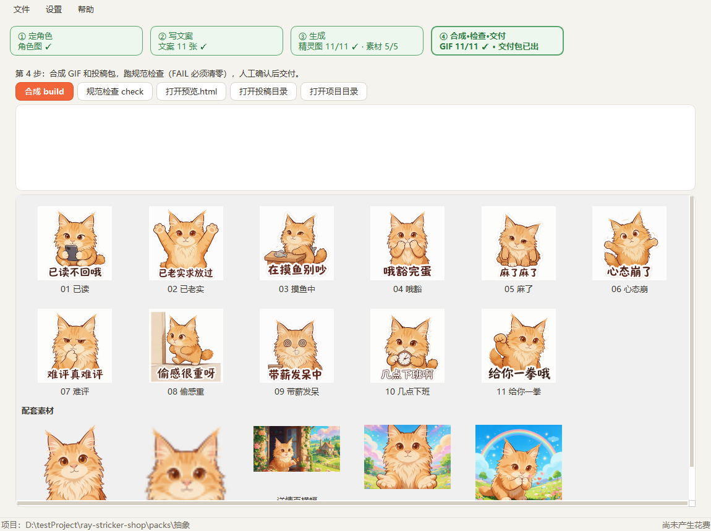
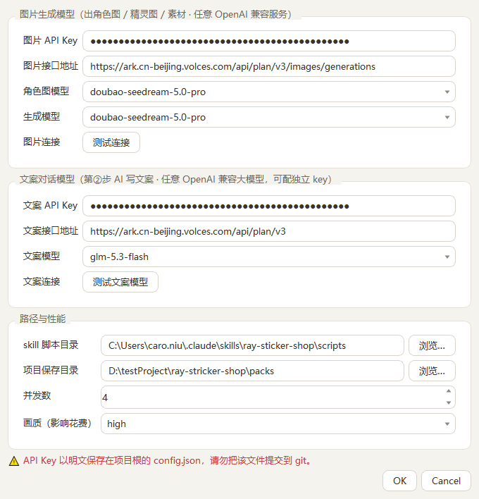

<div align="center">


# 表情包工坊 · StickerWorkshop

**一张照片进，一整套能上架微信表情开放平台的动态表情包出。**

不用敲命令行——上传照片生成卡通形象，AI 写好整套文案，逐张生成动图，
合成 GIF、跑微信规范检查、打出投稿包，全程图形界面点一点。

[](https://github.com/CaroNiu/Sticker-packs/releases/latest)
[](#-下载安装)
[](https://www.python.org/)
[](LICENSE)

</div>

---

## ✨ 特性

- **🎨 四步流水线 GUI**：① 定角色 → ② 写文案 → ③ 生成 → ④ 合成·检查·交付，顶部进度总览随时跳转，断点续跑
- **🤖 AI 全程打下手**：AI 生成整套文案初稿（人过目后才保存）；「抽象创意参谋」用错位手法出真正出人意料的选题
- **✎ 单张微调**：某张不满意？不用全抽重摇——右键缩略图「微调这张」，画风构图保持，只改你想改的
- **🔓 不锁定任何厂商**：任意 OpenAI 兼容大模型都能接——OpenAI / DeepSeek / GLM / Qwen / Kimi / 火山方舟 / 中转网关 / 本地 Ollama·vLLM
- **📚 专辑（系列）模式**：一个 IP 形象批量出多套，角色图自动继承、风格统一
- **🔌 无 Key 也能用**：没有 API Key 就复制出图提示词，去 ChatGPT 手动出图，回来点合成
- **✅ 微信规范内置**：平台审核规则做成了检查器，FAIL 清零才建议投稿
- **🛠 三平台自动打包**：推个版本标签，GitHub Actions 自动出 Windows exe + Mac（arm64/Intel）挂到 Release

## 📸 界面一览

| 定角色 | 写文案 |
|---|---|
|  |  |

| 生成（实时缩略图墙） | 合成·检查·交付（GIF 预览） |
|---|---|
|  |  |

<details>
<summary>⚙ 设置界面（两组模型独立配置，任意 OpenAI 兼容服务）</summary>



</details>

## 📥 下载安装

### 方式一：直接下载（推荐）

到 [**Releases**](https://github.com/CaroNiu/Sticker-packs/releases/latest) 下载对应平台：

| 文件 | 平台 | 用法 |
|---|---|---|
| `StickerWorkshop-vX.X.X-win.exe` | Windows | 双击即用 |
| `StickerWorkshop-vX.X.X-mac-arm64.zip` | macOS (Apple Silicon) | 解压 → 拖进「应用程序」→ **右键 → 打开**（未签名，首次需右键绕过 Gatekeeper） |
| `StickerWorkshop-vX.X.X-mac-intel.zip` | macOS (Intel) | 同上 |

首次运行在程序旁生成 `config.json`（填模型配置）和 `packs/`（作品目录）；
macOS 的数据在 `~/Library/Application Support/StickerWorkshop/`。

### 方式二：源码运行

```bash
git clone https://github.com/CaroNiu/Sticker-packs.git
cd Sticker-packs
pip install -r requirements.txt   # PySide6 + Pillow
python main.py
```

依赖的 skill 脚本（提示词、GIF 压缩、规范检查逻辑）首次使用前装一次：

```bash
git clone https://github.com/imraywang/ray-sticker-shop ~/.claude/skills/ray-sticker-shop
```

## 🤖 模型配置（不锁定厂商）

通用流水线设计：**任意 OpenAI 兼容大模型都能接**。设置里分「图片生成模型」「文案对话模型」
两组，各自独立填 API Key / 接口地址 / 模型名（可下拉选、也可手填任意模型 ID）：

| 用途 | 链路 | 适用服务 |
|---|---|---|
| 文案对话模型 | OpenAI 兼容 `POST {地址}/chat/completions` | OpenAI / DeepSeek / GLM / Qwen / Kimi / 火山方舟 / 中转聚合网关 / 本地 Ollama·vLLM |
| 图片生成模型 | OpenAI 兼容 multipart `/images/edits` | OpenAI 官方及支持该协议的任意网关 |
| 图片生成模型 | 方舟 JSON `images/generations`（识别到 volces.com 自动切换） | 火山方舟标准入口与 Coding 套餐入口 |

默认值面向 OpenAI 官方（`gpt-image-1` / `gpt-4o-mini`，接口地址留空即可）；换其他服务只需改
这三项配置——流水线本身（提示词、GIF 合成、规范检查）不感知厂商。两组模型可以用不同账号的 Key。

> ⚠ `config.json` 以明文保存 API Key（已进 `.gitignore`），勿提交、勿外传。

## 🚀 使用流程

| 步骤 | 做什么 | 小技巧 |
|---|---|---|
| **① 定角色** | 拖入照片 → 生成卡通角色图 | 这张图是整套形象的锚，不满意就重抽 |
| **② 写文案** | 「✨ AI 生成整套文案」→ 人工过目修改 → 保存；「💡 抽象创意参谋」可先出选题 | 名称 ≤8 字；含义词 ≤4 字不重复；动作写具体身体动作 |
| **③ 生成** | 先「预估花费」再「开始生成」；实时缩略图墙逐张上墙 | 已生成的自动跳过；某张不满意**右键微调**或填序号重抽 |
| **④ 合成·检查·交付** | 一键合成 GIF → 规范检查（FAIL 必须清零）→ 打开投稿目录 | 投稿包、预览 HTML、上架文案一并产出 |

## 🎁 特色功能

### ✎ 单张微调
第③步缩略图右键 →「✎ 微调这张…」：以**该图本身**为参考图重新生成，画风、构图、角色形象
保持不变，只按你的指令调整（快捷指令一键追加：表情更夸张 / 更Q更圆润 / 色调更暖…）。
比「重抽」（全随机）可控得多，费用 ≈ 一次普通生成。

### 💡 抽象创意参谋
「安全和常见」等于失败。创意参谋被要求必须用**错位手法**造词——自造伪术语（电子青菜）、
物种错位（精神水豚）、状态合成词（班味很重）、身体化情绪（脑内缓冲）、反向祝福（含班量超标）、
具体到荒诞（键盘出汗）——烂大街的首想词全部禁用。勾选心仪的选题，一键填入灵感提示。

### 📚 专辑（系列）模式
「文件 → 专辑管理器」：一个专辑 = 多套同形象表情包。新建套自动复制专辑里最新的角色图
（系列形象一致）、风格继承专辑设定，每套带独立的状态标签。散装项目互不影响。

## 📦 从源码打包

PyInstaller 不支持交叉编译，本机是什么平台就打什么包（GitHub Actions 打包见
`.github/workflows/release.yml`，推 `v*` 标签自动出三平台 Release）：

```bash
pip install PySide6 Pillow pyinstaller
python build_exe.py    # Windows 出单文件 exe；macOS 出 .app → zip
```

应用图标在打包时由 `theme.py` 的矢量绘制自动渲染（Windows `.ico` / macOS `.icns`），仓库无需二进制素材。

## 🧪 测试

```bash
for f in test_*.py; do python "$f"; done
```

覆盖：skill 加载 / 项目管理 / 文案与创意 JSON 容错（剥 `<think>`、平衡扫描、截断修复、自动纠偏重试）/
微调链路 / 方舟路由分发 / 缩略图墙 / 专辑模式 / GUI 僵尸线程免疫 / 厂商通用化。

## 📜 合规提醒

只做你有权使用的形象：不做明星、影视动漫游戏角色、二创同人；未成年人照片不投稿（仅可家长私下自用）。
微信注册与提交须本人实名操作，过审由微信决定。

## 🙏 致谢

- [imraywang/ray-sticker-shop](https://github.com/imraywang/ray-sticker-shop) —— 出图提示词、GIF 压缩、微信规范检查全部来自该 skill 本体，本项目是其图形界面封装

## License

[MIT](LICENSE)
